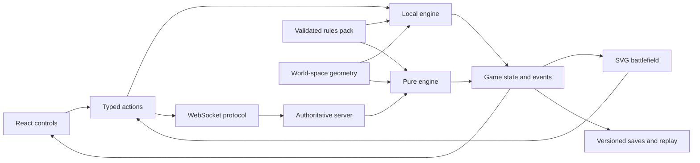

# Architecture

The project separates rendering from legality. The browser proposes actions; the pure engine accepts or rejects them. Online games run the same engine on a Node server. The bundled data is training content, and none of this structure establishes complete official 11th Edition coverage.

## Modules

| Path | Responsibility |
| --- | --- |
| `apps/web/src/` | Setup, player controls, rendering, selection, overlays, event presentation and browser persistence. |
| `apps/server/` | Bounded protocol messages, seat authorization, revision checks, room synchronization and durable room files. |
| `packages/shared/types.ts` | Game state, actions, model/weapon/unit/terrain definitions and save contracts. |
| `packages/shared/validation.ts` | Strict external-input schemas and pack consistency checks. |
| `packages/geometry/` | Circle/base distances, segment and polygon queries, swept collisions, coherency and spatial index. |
| `packages/engine/index.ts` | Match creation, legal actions, phase progression, deployment/movement, scoring and results. |
| `packages/engine/combat.ts` | Training target eligibility, visibility abstraction, attacks, saves and casualties. |
| `packages/engine/dice.ts` | Seeded random state, rejection-sampled D6 and training combat thresholds. |
| `packages/engine/persistence.ts` | Save envelopes, deterministic reconstruction, tamper/mismatch rejection and safe positioning undo. |
| `packages/rules-data/` | Original training profiles, formations, army validation, prices and battlefield layouts. |
| `tests/` | Geometry, data, engine, persistence, integration and browser specifications as authored. |

## State and transitions

`GameState` includes its schema/rules version, original config and pack, armies, models, terrain, resources, round/phase, random state, accepted actions and events. Coordinates are inches. Circular radii convert millimetre base diameters using `diameter / 50.8`.

`applyAction(state, action)` returns either a new accepted state or the identical input state with an error. The renderer never directly commits wounds, movement or dice. Rejected actions must not advance randomness. Phase and ownership checks occur in the engine as well as in the online protocol.

The current phase machine is intentionally simpler than complete 11th Edition timing. Initial pile-in, consolidation, reactions, simultaneous choices and optional allocation windows need richer substates before official support is possible. The current finite weapon-ability set is a small reusable dispatch mechanism, not a general event/trigger rules language.

## Geometry and rendering

Geometry runs in world units independent of screen size and camera transforms. Each living model has its own circle and wounds; a unit owns a group of models. Movement proposals contain one destination per surviving model and validate the swept path as well as the endpoint. The current movement path is a straight segment per model; arbitrary measured waypoint paths are not represented.

Terrain has polygon footprints and effect flags. Current line of sight uses a centre-to-centre ray blocked by opaque footprints. This does not reproduce true physical miniature visibility, windows or elevated floors. The schema can carry elevation metadata, but accepted model movement is currently ground level. Area/feature distinctions and official visibility exceptions require further engine work.

## Online authority and persistence

Each room has two seats. A room code permits claiming the unoccupied guest seat; a separate high-entropy seat token permits reconnection. Persisted files store token hashes, not the raw tokens. The server checks action ownership and expected state revision, then invokes the engine. Its live snapshots redact the seed and RNG state.

The server keeps rooms in memory and writes versioned match data through temporary-file rename under `MATCH_DIRECTORY`. This design requires **one process with one durable filesystem**. It does not support independent replicas or ephemeral serverless disks. Production hosting must provide WebSocket upgrades, TLS, persistent storage and an explicit frontend-origin allowlist.

The seeded generator supports replay and unbiased D6 mapping, but it is not a cryptographic anti-prediction system. Before competitive online use, replace live random generation with an auditable cryptographic design that preserves deterministic replay without exposing future results. Private-room availability, restart recovery and competing updates require integration tests.

## Saves and undo

A save contains both the claimed state and enough inputs to rebuild it. Loading parses the pack/config/actions, replays from the beginning and compares the rebuilt state with the saved state. Matching schema versions alone do not establish compatibility if engine behavior changes; releases need an engine-version migration policy before long-term save support is promised.

Undo accepts only the latest deployment or positioning action, reconstructs the previous state and verifies that it revealed no new random draws. It cannot erase a failed charge roll or attack. Local file ownership inherently allows users to create their own sandbox histories; online clients do not control authoritative saves.

## Adding future factions and mechanics

1. Add the faction identifier to `FactionId` and the input schema. Extend team names, colors and selection controls. Those identifiers are currently a two-faction union, so this is a small code change rather than a drop-in unlimited faction registry.
2. Add structured unit profiles with unique IDs, legal model-count/price pairs, base size, characteristics, weapons and copy limits. Add formations and their budget/eligibility data. Keep original or licensed data provenance distinct.
3. For a new ability, first define reusable semantics in engine/shared types and validation. Add explicit player-decision windows where needed; do not put legality in a React component or branch on a unit's display name.
4. Add army validation and deterministic interaction tests, including rejection cases and phase/resource boundaries. Verify mixed profiles and optional effects rather than relying on average damage alone.
5. Add a full-match browser scenario for the supported content. Record exact evidence and limitations in the coverage matrix.
6. Bump the pack version. If behavior or save shape changes, bump the appropriate engine/schema version and provide a deliberate migration or clear rejection.

An official pack also needs current source and amendment review, full mechanics coverage for its selections, lawful data handling and executed regression tests. A user-supplied pack cannot automatically enable an official status badge.

## Technology decisions

React/TypeScript/Vite, Node and WebSockets follow the preferred stack. SVG replaces the initially preferred PixiJS renderer for the current token battlefield: browser-native geometry, pointer interaction and inspection keep the first implementation smaller and easier to debug. This is a documented technology substitution, not a claim of comparable performance at very large model counts. Ordinary CSS and React state avoid extra styling/state dependencies. The engine remains usable without the UI. A spatial-index utility exists, but profiling and broad integration of indexing remain future work; its presence is not a performance benchmark.

The native Node test loader strips TypeScript for dependency-free engine tests on Node 22.15+. It is not a TypeScript type checker. Vitest still owns dependency-backed schemas/backend tests, and Playwright owns browser behavior.
